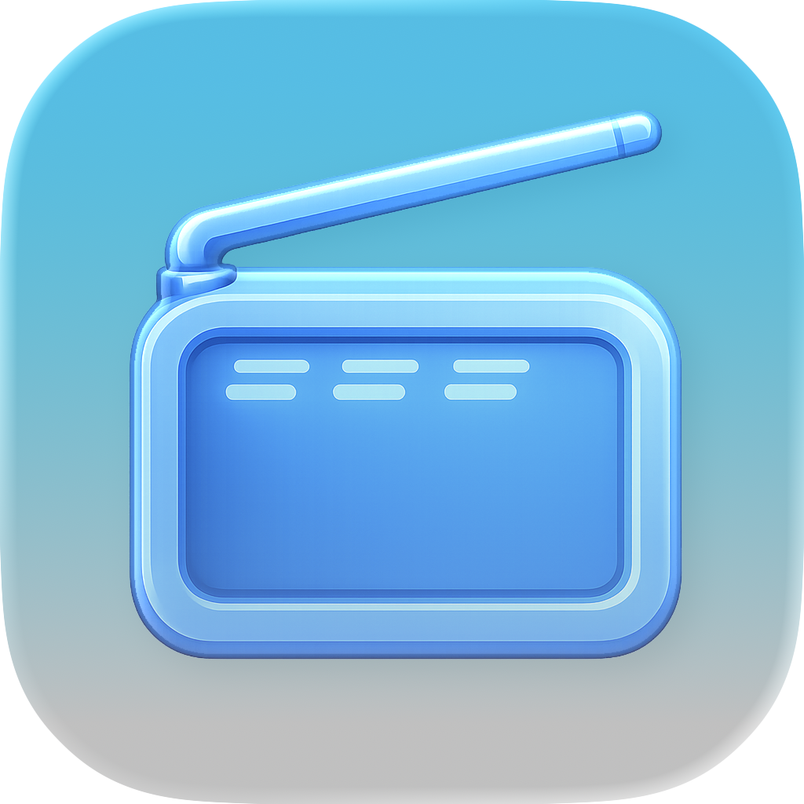
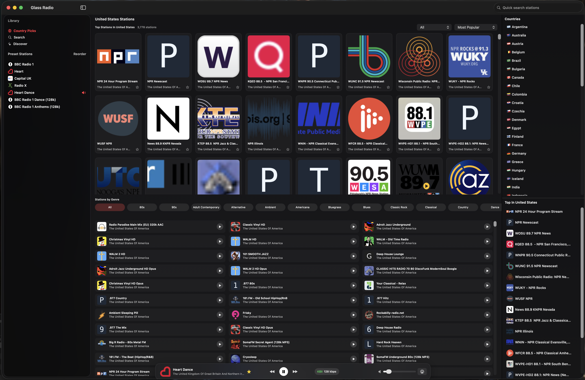
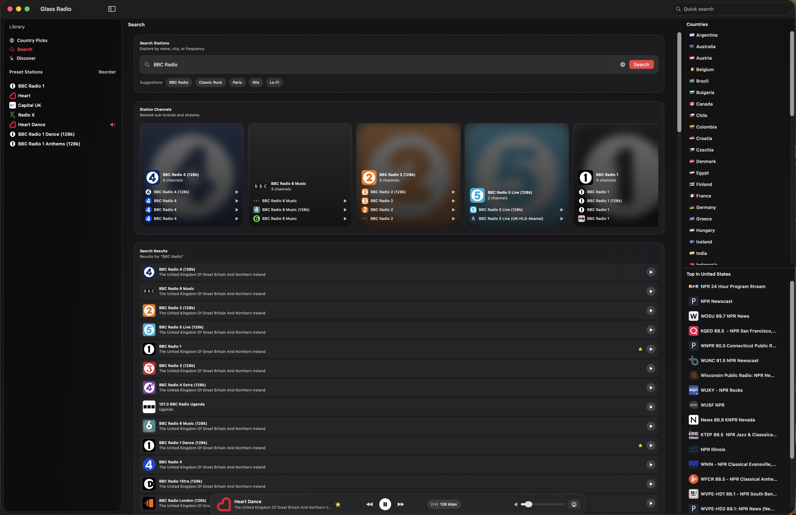
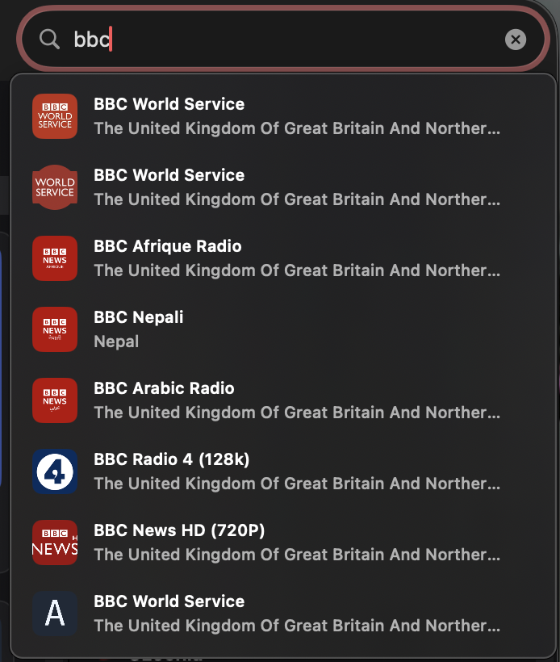
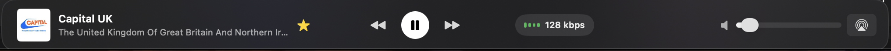
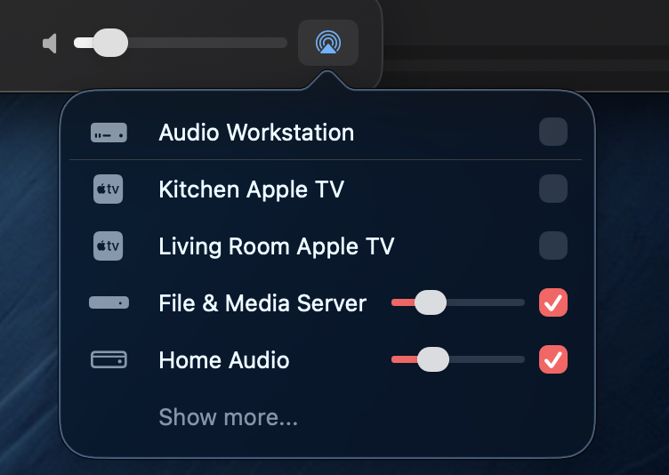

# Glass Radio

A liquid-glass internet radio app with global live station discovery, fast search, and
favorites — one app, built natively for macOS and Windows.

  

## Screenshots

## Feature highlights

| Feature | Preview |
| --- | --- |
| Quick search pop-down shows live matches and plays instantly |  |
| Player bar stays centered with throughput meter and volume controls |  |
| AirPlay routing is one click away from the main player (macOS) |  |

Global trending stations, curated top countries, country-level browsing, favorites,
recently played, and a built-in EQ and local API server for programmatic control.

## Platforms

Both builds are still under active development — expect rough edges.

### macOS
Native SwiftUI app. Supports macOS 13.0 and later — not just the latest release, so older
Macs stay usable. Includes AirPlay, Now Playing/media-key integration, a built-in parametric
EQ, and a local API server. Build from source (`macos/`) or grab the download below; see
[macos/README.md](macos/README.md) for build instructions.

### Windows
Native WinUI 3 port (.NET 9), not a wrapper — same liquid-glass visual design and feature
set as the macOS app. Ships as a self-contained installer (`Glass-Radio-Setup.exe`, WiX
Toolset) with a dual playback engine (libVLC, with a WinRT fallback) for reliable streaming.
See [windows/README.md](windows/README.md) for build instructions.

## Download

Latest releases (installer for Windows, app build for macOS): https://github.com/JoshABrasso/glass-radio/releases

## License

MIT — see [LICENSE](LICENSE).
